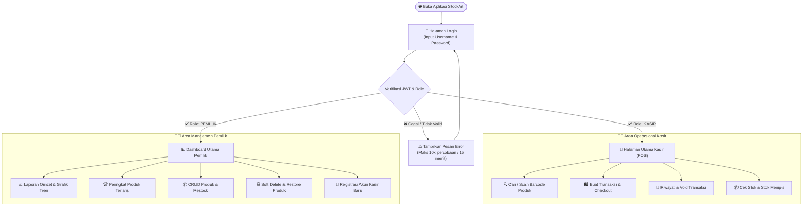
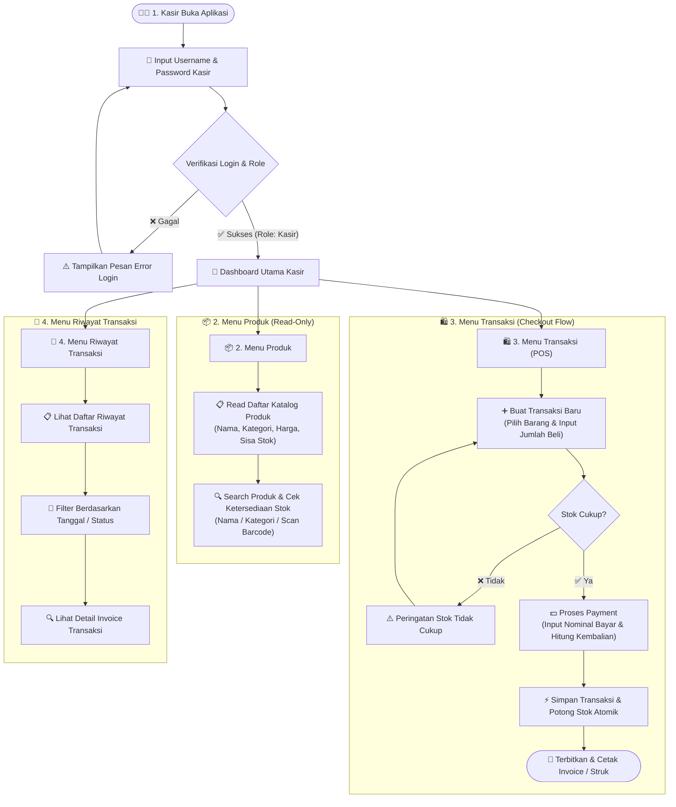
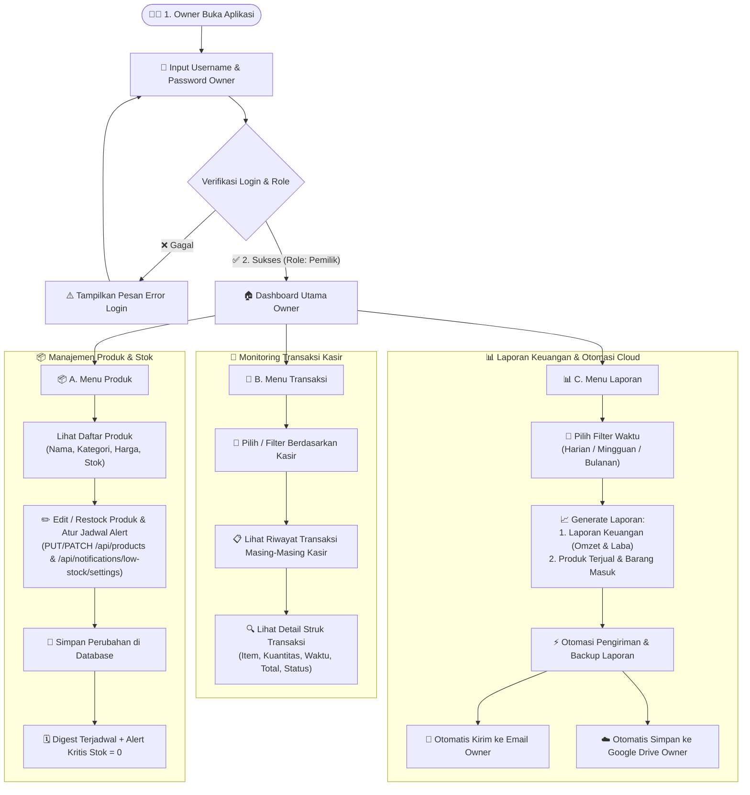

# StockArt Backend API

> **Sistem Kasir (Point of Sale) & Manajemen Inventaris Berbasis Web**  
> Proyek Tugas Akhir Mata Kuliah Pengembangan Aplikasi Web (PAW) — Milestone 1  
> Studi Kasus: **Toko Kelontong "Berkah" (User Story 5)**

[](https://nodejs.org/)
[](https://expressjs.com/)
[](https://www.mongodb.com/atlas)
[](https://stockart-backend-production-5896718b.up.railway.app)
[]()

---
1. Tautan Laporan PDF (Google Drive):
https://drive.google.com/drive/folders/1q-CFouyNM72jy04lbFyb3o5WhMakrGxF?usp=sharing

2. Tautan Repositori GitHub:
https://github.com/AfiqMir/stockart-backend

3. Tautan Live Server Deployment (Railway):
https://stockart-backend-production-5896718b.up.railway.app

4. Tautan Documenter Postman
https://documenter.getpostman.com/view/42234832/2sBYB4M79y
---

## 1. Deskripsi Aplikasi

**StockArt** adalah aplikasi kasir (*Point of Sale* / POS) dan manajemen inventaris modern berbasis web yang dirancang khusus untuk memodernisasi operasional harian **Toko Kelontong "Berkah"**. Aplikasi ini menyelesaikan permasalahan pencatatan manual, ketidaksesuaian stok barang dagangan, risiko *human-error* saat kalkulasi kasir, serta ketiadaan analisis omzet penjualan secara berkala.

Repositori ini berfokus pada **StockArt Backend**, yaitu fondasi server penyedia layanan **RESTful API** yang aman, tangguh, dan terukur. Layanan backend ini bertanggung jawab atas:
- **Autentikasi & Otorisasi Pengguna:** Pengelolaan sesi stateless berbasis JSON Web Token (JWT) yang diperkuat dengan *Role-Based Access Control* (RBAC) antara peran `pemilik` dan `kasir`. Registrasi kasir baru wajib diotorisasi oleh pemilik untuk mencegah pendaftaran liar.
- **Katalog & Manajemen Stok Terintegrasi:** CRUD produk, pelacakan stok masuk (*restock*), peringatan dini stok menipis (*low-stock warning*), pencarian fleksibel nama/kategori/barcode scanner (field `barcode` opsional & unik, lookup scan via `GET /api/products/barcode/:code`), serta dukungan *soft delete* untuk menjaga integritas data masa lalu.
- **Pemrosesan Transaksi Atomik:** Pencatatan struk belanja, snapshot harga produk saat transaksi, kalkulasi subtotal, pemotongan stok otomatis secara atomik (*ACID transaction session* di MongoDB), serta pembatalan transaksi (*void*) yang aman dan mengembalikan stok secara terkontrol.
- **Analisis & Laporan Bisnis:** Agregasi omzet harian, ringkasan performa penjualan berdasarkan rentang tanggal, dan peringkat produk terlaris (*top products*) untuk membantu pemilik toko mengambil keputusan strategis.

---

## 2. Tim Pengembang & Pembagian Tugas

**Nama Kelompok:** Kelompok PAW — Toko Kelontong Berkah  

| No | Nama Anggota | NIM | Peran / Pembagian Tugas |
|:--:|:---|:---:|:---|
| 1 | **Muhammad Afiq Mirza Choiruzan** | 24/537942/TK/59646 | **Authentication, Security & DevOps Module**<br>• Arsitektur Express & inisialisasi MongoDB Atlas<br>• Autentikasi JWT, hashing password Bcrypt, dan RBAC (`pemilik`/`kasir`)<br>• Hardening keamanan (Rate Limiter, validasi input body, CORS)<br>• Seeder akun awal (`seed.js`), HTTP integration test, dan deployment ke Railway |
| 2 | **Bagas Adjie Pamungkas** | 24/544718/TK/60547 | **Product & Inventory Module**<br>• Mongoose Schema Produk (`Product.js`) & constraint data<br>• RESTful API CRUD produk, pencarian filter, kategori, dan barcode scanner<br>• Mekanisme *Soft Delete* & *Restore* produk serta opsi *hard delete*<br>• Endpoint *Restock* penambahan stok dan filter *low-stock alerts*<br>• Seeder katalog produk toko kelontong (`seedProducts.js`) |
| 3 | **Amelia Ocha Maharani** | 24/534372/TK/59229 | **Transaction & POS Flow Module**<br>• Mongoose Schema Transaksi (`Transaction.js`) & snapshot harga item<br>• Endpoint draf belanja, validasi stok, dan kalkulasi subtotal otomatis<br>• Transaksi atomik MongoDB session (pemotongan stok aman saat checkout)<br>• Mekanisme pembatalan (*void*) transaksi atomik dan pengembalian stok<br>• Suite pengujian transaksi (`transaction.test.js`) & dokumentasi kontrak transaksi |
| 4 | **Muhammad Izzuddin Prakoso** | 24/537712/TK/59618 | **Report & Analytics Module**<br>• Perancangan pipeline MongoDB Aggregation untuk laporan bisnis<br>• Endpoint ringkasan performa penjualan & omzet (`/api/reports/summary`)<br>• Agregasi tren pendapatan harian (`/api/reports/revenue`) untuk visualisasi grafik<br>• Agregasi produk terlaris (`/api/reports/top-products`) dengan metrik kuantitas & omzet<br>• Proteksi RBAC khusus peran `pemilik` pada seluruh rute laporan |

---

## 3. Struktur Folder dan File Proyek

Berikut adalah diagram pohon (*ASCII directory tree*) struktur direktori backend StockArt beserta rincian fungsi tiap komponen arsitektural:

```text
stockart-backend/
├── config/
│   └── db.js                    # Konfigurasi koneksi database MongoDB Atlas via Mongoose
├── controllers/
│   ├── authController.js         # Logika login, registrasi kasir terotorisasi, dan get current user profile
│   ├── notificationController.js # Handler pengaturan jadwal notifikasi low stock (GET/PUT settings)
│   ├── productController.js      # Logika CRUD produk, restock, low-stock, trigger manual alert, dan soft-delete
│   ├── reportController.js       # Pipeline agregasi laporan omzet harian, summary, dan produk terlaris
│   └── transactionController.js  # Handler checkout transaksi, alert kritis stok habis, riwayat, dan void struk
├── middleware/
│   ├── authMiddleware.js         # Middleware verifikasi token JWT (protect) dan hak akses peran (authorize)
│   ├── rateLimiter.js            # Middleware pencegah serangan brute-force pada endpoint autentikasi
│   └── validate.js               # Middleware validasi skema dan sanitasi body request sebelum ke controller
├── models/
│   ├── NotificationSetting.js    # Mongoose schema jadwal digest low-stock, status eksekusi, dan alert kritis
│   ├── Product.js                # Mongoose schema produk (stok, harga beli/jual, barcode, status aktif, stokHabisNotifiedAt)
│   ├── Transaction.js            # Mongoose schema transaksi (daftar item, total, nominal bayar, kembalian, status)
│   └── User.js                   # Mongoose schema pengguna toko (nama, username, password ter-hash, role)
├── routes/
│   ├── authRoutes.js             # Routing endpoint otentikasi (/api/auth)
│   ├── notificationRoutes.js     # Routing endpoint pengaturan notifikasi (/api/notifications)
│   ├── productRoutes.js          # Routing endpoint katalog produk (/api/products)
│   ├── reportRoutes.js           # Routing endpoint analisis & pelaporan bisnis (/api/reports)
│   └── transactionRoutes.js      # Routing endpoint kasir & checkout (/api/transactions)
├── scripts/
│   ├── generateBarcodeSheet.js   # Buat lembar cetak barcode (HTML, SVG EAN-13/CODE128) untuk demo scan
│   ├── seed.js                   # Script inisialisasi akun pemilik default (idempotent / aman dijalankan ulang)
│   ├── seedBarcodes.js           # Isi barcode EAN-13 dummy ("200...") untuk produk tanpa barcode + ekspor CSV
│   └── seedProducts.js           # Script pengisian 30+ data sampel produk toko kelontong (sembako, dsb.)
├── services/
│   ├── emailService.js           # Layanan pengiriman email (Brevo HTTP API & Nodemailer SMTP) termasuk template digest/kritis
│   ├── lowStockAlertService.js   # Trigger 1x alert kritis saat checkout membuat stok = 0 & reset flag saat restock/void
│   ├── lowStockDigestService.js  # Scheduler persistent rekap low-stock terjadwal (atomic lock, catch-up, retry)
│   ├── lowStockSchedule.js       # Kalkulator slot jadwal WIB UTC+7 (off, daily, weekly, monthly)
│   ├── lowStockSettingsService.js# Baca, validasi, dan update pengaturan notifikasi di MongoDB
│   └── transactionService.js     # Business logic transaksi atomik MongoDB session (checkout & void with rollback)
├── test/
│   ├── criticalAlert.test.js     # E2E test alert kritis stok = 0, reset flag saat restock/update/void
│   ├── email.test.js             # Unit test penyusunan subjek & isi email digest, kritis, dan manual
│   ├── generateBarcodeSheet.test.js # Unit test render SVG (EAN-13/CODE128 fallback) & HTML lembar barcode
│   ├── http.test.js              # HTTP Integration test endpoint utama (Auth, RBAC, CRUD, Report)
│   ├── lowStockDigest.test.js    # Test scheduler digest (atomic claim, anti-duplikat restart, retry, skip)
│   ├── lowStockSchedule.test.js  # Unit test kalkulasi jadwal WIB UTC+7 (daily, weekly, monthly, off)
│   ├── lowStockSettings.test.js  # Test persistensi & validasi pengaturan notifikasi di MongoDB
│   ├── notificationRoutes.test.js# HTTP + RBAC test GET/PUT /api/notifications/low-stock/settings
│   ├── product.test.js           # Integration test controller produk (CRUD, restock, trigger manual low-stock)
│   ├── rbac.test.js              # Unit test fungsional middleware otorisasi RBAC (pemilik vs kasir)
│   ├── seedBarcodes.test.js      # Unit test check digit EAN-13, penomoran dummy, rencana idempoten, dan CSV
│   └── transaction.test.js       # Unit test transaksi atomik, rollback, void, dan pemotongan stok
├── .env.example                 # Template variabel lingkungan (Environment Variables)
├── .gitignore                   # Daftar file dan direktori yang diabaikan oleh Git
├── API_TESTING.md               # Panduan pengujian manual API menggunakan cURL
├── app.js                       # Konfigurasi Express app, CORS, parsing JSON, rute, dan global error handler
├── index.js                     # Entry point server (koneksi database dan inisialisasi HTTP server listen)
├── package.json                 # Metadata proyek, dependensi npm, dan script runner (start, dev, test)
├── PROGRESS.md                  # Log kemajuan pengerjaan teknis modul setiap anggota tim
├── README.md                    # Dokumentasi utama proyek backend
├── render.yaml                  # Konfigurasi infrastruktur alternatif deployment (Render)
├── StockArt_API.postman_collection.json # Koleksi pengujian Postman API v2.1 lengkap dengan skrip token otomatis
└── TRANSACTION_API.md           # Panduan spesifikasi dan kontrak integrasi transaksi untuk Frontend
```

---

## 4. Teknologi yang Digunakan

Aplikasi backend ini dikembangkan dengan tumpukan teknologi modern yang mengedepankan performa, konsistensi data, dan keamanan:

| Komponen | Teknologi | Keterangan & Rationale |
|:---|:---|:---|
| **Runtime Environment** | **Node.js (v18+)** | Lingkungan eksekusi JavaScript server-side asinkron berbasis event-driven V8 engine. |
| **Web Framework** | **Express.js (v5)** | Framework web minimalis dan fleksibel untuk routing RESTful API dan manajemen middleware. |
| **Database & ODM** | **MongoDB Atlas & Mongoose (v9)** | Cloud NoSQL database berbasis kluster replica-set yang mendukung transaksi multi-dokumen ACID atomik, diakses melalui Mongoose Object Data Modeling. |
| **Stateless Authentication** | **JSON Web Token (jsonwebtoken v9)** | Penyedia token akses berjangka waktu (bearer token) untuk memvalidasi identitas pengguna pada setiap request. |
| **Password Hashing** | **Bcrypt.js (v3)** | Enkripsi satu arah dengan *salt rounds* untuk melindungi kata sandi pengguna di basis data. |
| **API Security & Limiter** | **Express-Rate-Limit & CORS** | Pembatasan beban request (anti brute-force) serta kontrol kebijakan pembagian sumber daya lintas domain (*Cross-Origin Resource Sharing*). |
| **Automated Testing** | **Node.js Built-in Test Runner (`node --test`)** | Pengujian unit dan integrasi native tanpa overhead dependensi eksternal, mencakup pengujian RBAC, REST API, dan transaksi atomik. |
| **Platform Deployment** | **Railway Cloud** | Platform PaaS modern untuk hosting server backend live 24/7 dengan dukungan environment variables terenkripsi. |

---

## 5. Tautan Dokumen Laporan (Milestone 1)

Laporan lengkap Tugas Akhir Milestone 1 mencakup analisis kebutuhan sistem, spesifikasi API, perancangan database, serta dokumentasi pengujian dapat diakses melalui tautan Google Drive berikut:

🔗 **Google Drive Laporan Milestone 1:**  
[**Dokumen Laporan Milestone 1 — StockArt (Google Docs)**](https://docs.google.com/document/d/1rUfcUpfr8B4z9RHyZvWftt7V0eCu8C3IxLhTlQwGSjY/edit?usp=sharing)

> **Catatan Akses Dokumen:**  
> Tautan di atas telah diatur dengan hak akses publik (*"Anyone with the link can view"* / *"Siapa saja yang memiliki link dapat melihat"*).

---

## 6. Live Deployment & Akses API

Server backend telah berhasil di-deploy ke lingkungan produksi (PaaS Railway Cloud) dan aktif melayani request selama 24 jam nonstop:

- **Base URL Server Produksi:**  
  [`https://stockart-backend-production-5896718b.up.railway.app`](https://stockart-backend-production-5896718b.up.railway.app)
- **Health Check Endpoint:**  
  `GET https://stockart-backend-production-5896718b.up.railway.app/`  
  *(Mengembalikan status server aktif beserta tautan dokumentasi)*

---

## 7. Panduan Instalasi & Menjalankan di Lokal (*Local Setup*)

Ikuti langkah-langkah di bawah ini untuk menjalankan server backend StockArt di komputer lokal:

### Prasyarat Sistem
- **Node.js**: Versi 18.0.0 atau lebih tinggi ([Unduh Node.js](https://nodejs.org/))
- **Git**: Terpasang pada terminal
- **MongoDB**: Kluster MongoDB Atlas Cloud aktif (atau MongoDB Replica Set lokal untuk mendukung fitur transaksi atomik)

### Langkah Instalasi

1. **Clone Repositori:**
   ```bash
   git clone https://github.com/AfiqMir/stockart-backend.git
   cd stockart-backend
   ```

2. **Pasang Dependensi:**
   ```bash
   npm install
   ```

3. **Konfigurasi Environment Variables:**
   Salin berkas `.env.example` menjadi `.env`:
   ```bash
   cp .env.example .env
   ```
   Buka berkas `.env` dan sesuaikan nilainya:
   ```env
   PORT=5000
   MONGO_URI=mongodb+srv://<username>:<password>@<cluster>.mongodb.net/stockart?retryWrites=true&w=majority
   JWT_SECRET=rahasia-kunci-jwt-anda-yang-sangat-panjang-dan-acak
   CORS_ORIGIN=http://localhost:3000

   # Pembayaran QRIS - HANYA sandbox (lihat QRIS_PAYMENT.md)
   MIDTRANS_SERVER_KEY=SB-Mid-server-xxxxxxxx
   MIDTRANS_BASE_URL=https://api.sandbox.midtrans.com
   ```

4. **Inisialisasi Data Default (Seeding):**
   Jalankan script seeder untuk membuat akun pemilik awal dan sampel katalog produk toko kelontong:
   ```bash
   # 1. Buat akun pemilik awal (username: pemilik, password: gantidulu123)
   node scripts/seed.js

   # 2. Isi katalog 30+ sampel produk toko kelontong
   node scripts/seedProducts.js

   # 3. (Opsional) Isi barcode dummy untuk uji scan barcode
   npm run seed:barcodes -- --dry-run   # lihat rencana saja, DB tidak diubah
   npm run seed:barcodes                # isi produk yang belum punya barcode
   ```

   **Barcode dummy (`scripts/seedBarcodes.js`):**
   - Format EAN-13: `"200"` + 9 digit nomor urut + 1 check digit (mis. `2000000000015`). Prefix `200` adalah
     rentang *in-store* (sirkulasi internal), jadi tidak bentrok dengan barcode pabrik.
   - Idempoten: produk yang sudah punya barcode dilewati; nomor urut dilanjutkan dari barcode dummy tertinggi di DB.
   - `--force` menomori ulang semua barcode dummy (`200...`) mulai dari 1. Barcode lain (mis. barcode pabrik
     yang diisi manual) **tidak pernah** ditimpa.
   - Selesai menulis, daftar `kodeProduk,nama,barcode` disimpan di `scripts/output/barcodes.csv` (di-ignore Git)
     untuk dicetak sebagai label uji. Dry run tidak menulis CSV.
   - Script memakai koneksi `config/db.js` yang sama dengan server; pastikan `.env` menunjuk ke DB yang benar.

   **Lembar barcode untuk demo (`scripts/generateBarcodeSheet.js`):**
   ```bash
   npm run barcode:sheet   # -> scripts/output/barcode-sheet.html
   ```
   - Mengambil semua produk yang punya `barcode`, lalu membuat satu halaman HTML berisi kartu
     (nama, harga jual, gambar barcode SVG, dan angkanya). Produk aktif tampil lebih dulu; produk
     nonaktif diberi label **Nonaktif** karena kasir akan mendapat 404 saat men-scan-nya.
   - Barcode 13 digit dengan check digit valid dirender sebagai **EAN-13**, selain itu **CODE128**.
     Render memakai `bwip-js` (devDependency, menghasilkan SVG langsung di Node tanpa DOM).
   - Buka file di browser untuk scan langsung dari layar, atau cetak (Ctrl+P, A4, skala 100%):
     3 × 4 = 12 kartu per halaman dan kartu tidak terpotong antar halaman.
   - Tips scan dari layar: naikkan kecerahan layar dan jauhkan HP ±15–25 cm agar kamera fokus.

5. **Menjalankan Pengujian Otomatis (Automated Testing):**
   Pastikan seluruh test suite lulus pengujian:
   ```bash
   npm test
   ```

6. **Menjalankan Server Pengembangan:**
   ```bash
   npm run dev
   ```
   Server akan aktif di `http://localhost:5000`.

---

## 8. Ringkasan Endpoint Utama & Postman Collection

| Modul | Method | Endpoint | Otorisasi | Deskripsi |
|:---|:---:|:---|:---:|:---|
| **Auth** | `POST` | `/api/auth/login` | Publik | Login pengguna & mendapatkan token JWT |
| | `POST` | `/api/auth/register` | Pemilik | Pendaftaran akun kasir baru (diproteksi) |
| | `GET` | `/api/auth/me` | Kasir / Pemilik | Mendapatkan profil akun yang sedang login |
| **Produk** | `GET` | `/api/products` | Kasir / Pemilik | Katalog produk aktif (dukung search, kategori, `?barcode=` exact ke `barcode` atau `kodeProduk`) |
| | `GET` | `/api/products/low-stock` | Kasir / Pemilik | Daftar produk dengan stok di bawah batas minimum |
| | `POST` | `/api/products/low-stock/notify` | Pemilik | Kirim rekap email low-stock secara manual ke email pemilik |
| | `GET` | `/api/products/barcode/:code` | Kasir / Pemilik | Lookup produk hasil scan (exact `barcode` atau `kodeProduk`); kasir hanya produk aktif tanpa `hargaBeli`, 404 jika belum terdaftar |
| | `GET` | `/api/products/:id` | Kasir / Pemilik | Detail produk berdasarkan ID |
| | `POST` | `/api/products` | Pemilik | Menambahkan produk baru |
| | `PUT` | `/api/products/:id` | Pemilik | Memperbarui informasi produk |
| | `PATCH` | `/api/products/:id/restock` | Pemilik | Menambah jumlah stok barang masuk |
| | `DELETE` | `/api/products/:id` | Pemilik | Menonaktifkan produk (*soft delete*) / hapus permanen (`?permanent=true`) |
| | `PATCH` | `/api/products/:id/restore` | Pemilik | Mengaktifkan kembali produk yang dinonaktifkan |
| **Notifikasi** | `GET` | `/api/notifications/low-stock/settings` | Pemilik | Melihat jadwal digest low-stock & status eksekusi terakhir |
| | `PUT` | `/api/notifications/low-stock/settings` | Pemilik | Mengatur jadwal digest (`off`/`daily`/`weekly`/`monthly`) & alert kritis `stok = 0` |
| **Transaksi**| `POST` | `/api/transactions/checkout`| Kasir / Pemilik | Checkout transaksi penjualan & pemotongan stok atomik |
| | `GET` | `/api/transactions` | Kasir / Pemilik | Riwayat transaksi (filter tanggal WIB, status, kasir) |
| | `GET` | `/api/transactions/:id` | Kasir / Pemilik | Detail struk transaksi lengkap |
| | `PATCH` | `/api/transactions/:id/void` | Kasir / Pemilik | Pembatalan transaksi & pengembalian stok barang |
| | `GET` | `/api/transactions/:id/status` | Kasir / Pemilik | Status pembayaran untuk polling QRIS (hanya membaca) |
| **Pembayaran** | `POST` | `/api/payments/qris` | Kasir / Pemilik | Buat transaksi QRIS pending + QR dinamis Midtrans (sandbox) |
| | `POST` | `/api/payments/webhook` | Midtrans (signature) | Notifikasi Midtrans; satu-satunya jalan status menjadi *paid* |
| **Laporan** | `GET` | `/api/reports/summary` | Pemilik | Ringkasan total omzet, transaksi, dan produk |
| | `GET` | `/api/reports/revenue` | Pemilik | Data pendapatan per tanggal WIB untuk grafik tren (`?interval=jam` untuk per jam) |
| | `GET` | `/api/reports/top-products` | Pemilik | 5 produk terlaris berdasarkan kuantitas & omzet |

> 💳 **Pembayaran QRIS:** panduan env, ngrok, Notification URL, checklist uji, dan daftar perubahan untuk production
> ada di [`QRIS_PAYMENT.md`](./QRIS_PAYMENT.md).

> 💡 **File Pengujian Postman:**  
> File koleksi lengkap telah disediakan pada berkas [`StockArt_API.postman_collection.json`](./StockArt_API.postman_collection.json). Koleksi ini telah dilengkapi dengan skrip *pre-request* dan *tests* otomatis untuk menyimpan dan meneruskan token JWT ke setiap request.

---

## 9. Alur Pengguna (*User Flow*)

Aplikasi **StockArt** membagi alur pengguna berdasarkan peran (*Role-Based Access Control*): **Kasir** dan **Pemilik**. Diagram di bawah ini otomatis dirender secara visual oleh GitHub:

### 9.1 Diagram Alur Utama (*Role & Access Flow*)



---

### 9.2 Diagram Alur Kasir (*Cashier Dashboard Flow*)



1. **Login Kasir:** Kasir masuk menggunakan akun kasir (`POST /api/auth/login`) dan diarahkan ke **Dashboard Kasir**.
2. **Menu Produk (*Read & Search Stok*):**
   - Melihat daftar katalog produk secara *read-only* tanpa akses ubah/hapus (`GET /api/products`).
   - Mencari barang (berdasarkan nama, kategori, atau barcode) untuk mengecek ketersediaan stok secara cepat.
3. **Menu Transaksi (*Payment & Invoice*):**
   - **Membuat Transaksi:** Memilih barang ke keranjang belanja dan memvalidasi kecukupan stok.
   - **Payment:** Memasukkan nominal pembayaran pelanggan, menghitung kembalian otomatis, dan mengeksekusi checkout atomik (`POST /api/transactions/checkout`).
   - **Invoice:** Menghasilkan dan menampilkan struk/invoice transaksi yang siap dicetak.
4. **Menu Riwayat Transaksi:**
   - Menampilkan daftar riwayat transaksi yang telah diproses (`GET /api/transactions`) beserta rincian invoice tiap transaksi (`GET /api/transactions/:id`).

---

### 9.3 Diagram Alur Pemilik Toko (*Owner Dashboard Flow*)



1. **Login Owner:** Pemilik masuk menggunakan kredensial khusus `pemilik` (`POST /api/auth/login`). Jika terverifikasi, sistem mengarahkan ke **Dashboard Owner**.
2. **A. Menu Produk & Jadwal Notifikasi:**
   - Menampilkan dan mengedit seluruh atribut produk meliputi **Nama, Kategori, Harga, dan Stok** (`POST / PUT / PATCH / DELETE /api/products`).
   - Memantau ketersediaan stok barang (`GET /api/products/low-stock`), mengatur jadwal **digest rekap berkala** (`off`/`daily`/`weekly`/`monthly` WIB via `/api/notifications/low-stock/settings`) serta **alert kritis otomatis saat `stok = 0`** pada transaksi checkout, dan menyediakan tombol kirim manual (`POST /api/products/low-stock/notify`).
3. **B. Menu Transaksi:**
   - Memantau **riwayat transaksi dari masing-masing kasir** (`GET /api/transactions?kasir=<id>`) beserta rincian struk belanja per transaksi (`GET /api/transactions/:id`).
4. **C. Menu Laporan:**
   - Menyajikan laporan **Harian (*Daily*), Mingguan (*Weekly*), dan Bulanan (*Monthly*)** untuk **Keuangan (Omzet)** serta **Produk yang Terjual dan Barang Masuk** (`GET /api/reports/summary`, `/revenue`, `/top-products`).
   - Dilengkapi **Filter Waktu** (Hari, Minggu, Bulan) serta fitur **otomatis kirim laporan ke Email Owner dan simpan ke Google Drive Owner**.

